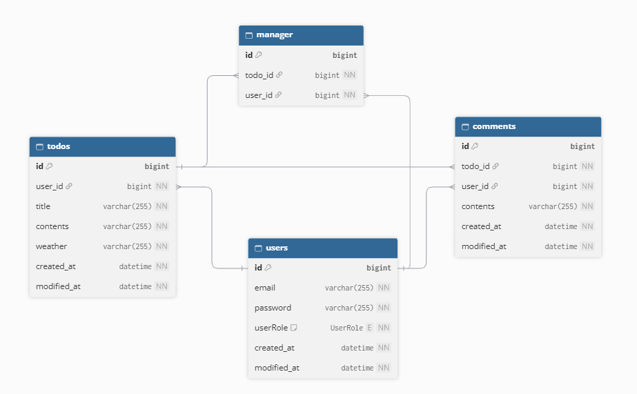
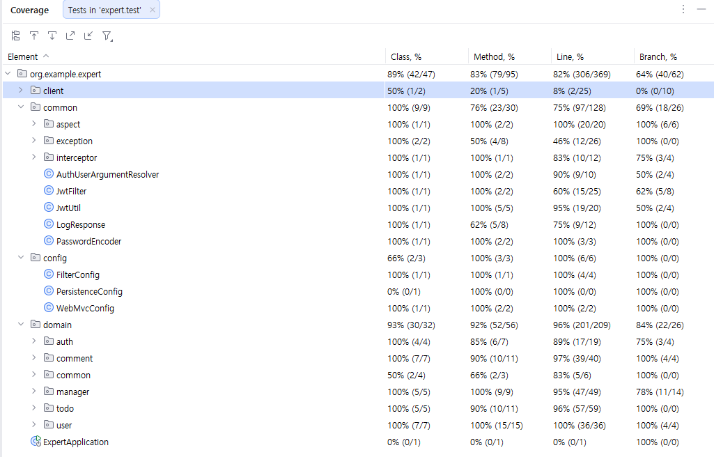

# 📅 Expert Spring_코드 개선
Spring Boot 기반의 사용자 및 일정 관리 코드 개선 프로젝트!

 

#### 프로젝트 기록: [Velog] 
#### 문제 해결 과정: [Notion](https://bolder-shrimp-6f4.notion.site/Spring_-40fdf7a8441c803fb9c2e8ddd31b1266)
#### 테스트용 Collection: [Postman Collection]

---

### 🗺️ Entities & 연관관계
> `@ManyToOne`을 활용한 단방향 연관관계 매핑 ('>'로 표시)
- todos > users
- managers > todos, users
- comments > todos, users

---
### 주요 기능 및 구현 내용

- Lvl 0. 프로젝트 세팅 - 에러 분석 (application.yml 파일 추가)
- Lvl 1. Argument Resolver 등록 (WebMvcConfig 구현)
- Lvl 2. Early Return, 불필요한 if-else 제거, Bean Validation
- Lvl 3. JPA N+1 문제 개선 (@EntityGraph)
- Lvl 4. 테스트 코드 수정 + 서비스 로직 개선 
- Lvl 5. Interceptor + AOP 기반 로깅
- Lvl 6. 추가 문제 정의 및 해결 (Notion)
- Lvl 7. 테스트 커버리지

---

### 📑 테스트 커버리지

